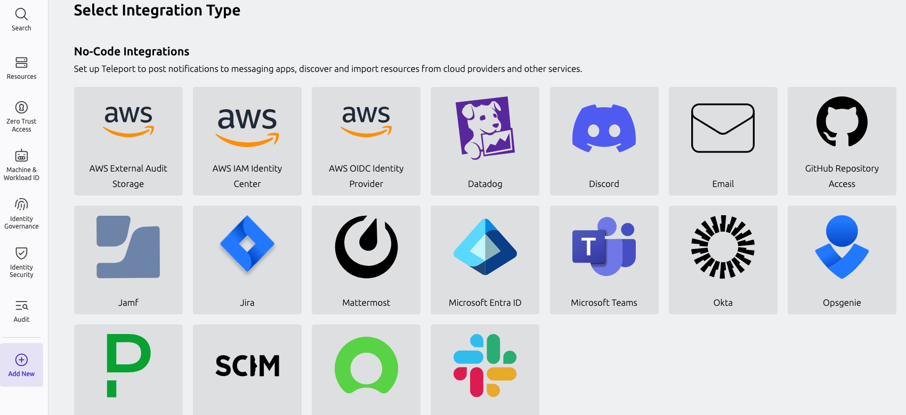

In Teleport Enterprise Cloud, Teleport manages {props.name ?? "this integration"} for you, and you can
enroll {props.name ?? "this integration"} from the Teleport Web UI.

Visit the Teleport Web UI and on the left sidebar, click **Add New** followed
by **Integration**:

On the "Select Integration Type" menu, click the tile for your integration. You
will see a page with instructions to set up the integration, as well as a form
that you can use to configure the integration.
